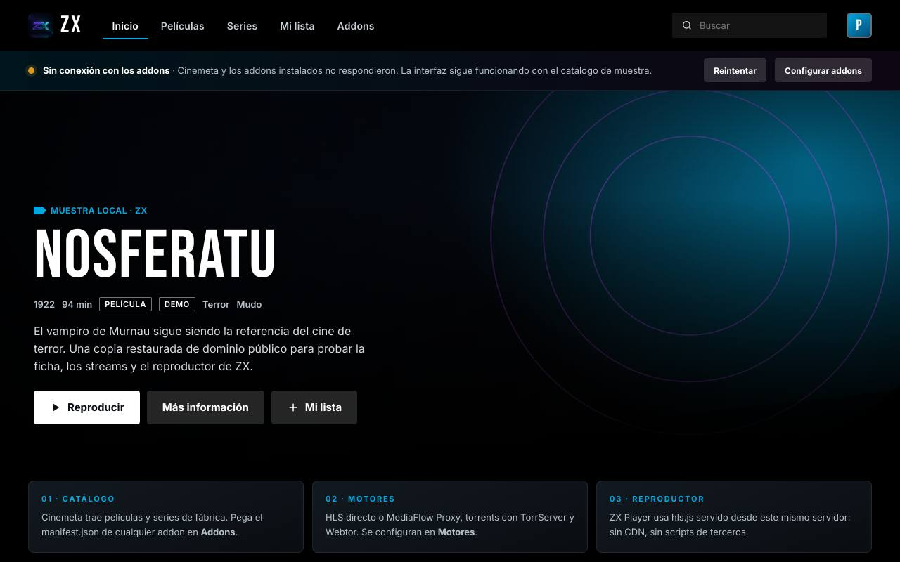

# ZX Web — cliente de addons Stremio

Interfaz web que instala **addons de Stremio** (`manifest.json`) y reproduce sus streams con:

| Motor | Para qué |
| --- | --- |
| **MediaFlow Proxy** | HLS / DASH / HTTP con cabeceras (`Referer`, `Origin`) |
| **TorrServer** | `infoHash` / magnet → HTTP Range local |
| **Webtor API v1** | REST `https://api.webtor.io/v1` (`Authorization: Bearer`). Las URLs de stream salen ya firmadas hacia `*.api.cosmic-crab.buzz` |
| **ZX Player (Media3)** | Reproductor HTML5 inspirado en Media3 ExoPlayer + `hls.js` |

Media3 ExoPlayer es una librería de Android: en el navegador no puede ejecutarse. ZX Player replica su barra de controles, *seek*, velocidad, subtítulos y teclas (espacio, flechas, F, M, Esc) sobre MSE/`hls.js`.



## Arranque

```bash
npm run web
# http://0.0.0.0:8787
```

Cinemeta viene instalado para catálogos y fichas. En **Addons** pega cualquier `https://…/manifest.json` (Torrentio, MediaFusion, el Worker Vimeus de este repo, etc.).

## Render sin red (primer pintado)

La web está preparada para verse completa en una preview o en una LAN sin
salida a internet:

- **Sin CDN**: `hls.js` está en `public/vendor/` y las tipografías Inter, Bebas
  Neue e IBM Plex Mono en `public/fonts/` (licencias en
  [`THIRD_PARTY.md`](THIRD_PARTY.md)). `index.html` incluye una pantalla de
  carga mínima con estilos en línea y un mensaje de error si un módulo falla.
- **Arranque no bloqueante**: `app.js` pinta el héroe, las filas y el estado de
  conexión antes de pedir nada a la red. `refreshManifests()` corre en segundo
  plano. Un contador de render evita que respuestas tardías pisen la vista
  actual.
- **Catálogo de muestra local**: `public/js/demo.js` genera fichas de dominio
  público con pósters SVG. Se muestran marcadas como «Muestra local» mientras
  los addons cargan o si fallan; en cuanto un addon real devuelve metas, el
  tablero se sustituye. La tira de estado ofrece **Reintentar** y acceso a
  **Addons**.
- **Perfil único**: se entra directo; el selector sigue accesible desde el
  avatar y tiene un botón **Entrar** explícito.

Los streams de muestra apuntan a fuentes de prueba públicas (Mux HLS y el MP4
de MDN): la interfaz y el reproductor funcionan sin addons, pero esos vídeos
concretos sí necesitan internet.

Tests de render (jsdom + servidor efímero):

```bash
npm test     # incluye test/web.render.test.mjs, web.catalog.test.mjs y web.static.test.mjs
```

## Ajustes

En **Motores** configura las URLs de tu red. TorrServer y MediaFlow se llaman **desde el navegador** (suelen vivir en tu LAN: `127.0.0.1:8090` / `:8888`). Webtor pasa por el proxy CORS del servidor.

Docker de referencia:

```bash
docker run -p 8888:8888 -e API_PASSWORD=secreto mhdzumair/mediaflow-proxy
docker run -p 8090:8090 ghcr.io/yourok/torrserver
```

## Webtor API ([docs](https://api.webtor.io/v1/docs/index.html))

Contrato que usa ZX:

1. `POST /resource` — cuerpo = magnet en crudo (`text/plain`). Devuelve el infohash. Un magnet frío puede tardar minutos (408 si no resuelve).
2. `GET /resource/{id}/list?output=list` — `id` de cada archivo es el `content_id` de export. `limit` por defecto es 10; ZX pagina.
3. `GET /resource/{id}/export/{content_id}?types=stream,download` — `exports.stream` / `html_tag.sources`. **Las URLs llevan su propia auth y caducan: no se guardan ni se reescribe el host.**
4. Opcional `POST /library` `{ "resource_id" }` para que aparezca en WebDAV/S3.
5. `GET /profile` — plan y email. Sin key o plan free → `unauthorized` / `payment_required` (402).
6. Device login: `POST /device/code` + `POST /device/token` (RFC 8628), botón «Vincular con webtor.io».

La key se emite en [webtor.io/profile](https://webtor.io/profile). El host `abra--5e4bd524.api.cosmic-crab.buzz` **no** es el REST: es un nodo de export al que apuntan esas URLs firmadas.

## Cómo se elige el motor

1. URL HTTP/HLS/DASH → directo, o MediaFlow si hay cabeceras / `notWebReady`.
2. Torrent (`infoHash` / magnet) → TorrServer, y si falla Webtor (`auto`).
3. `ytId` / `externalUrl` → se abre fuera.

El servidor (`server.mjs`) sólo sirve estáticos y un proxy a hosts **públicos** (`/api/fetch`). No reenvía a localhost (SSRF).
